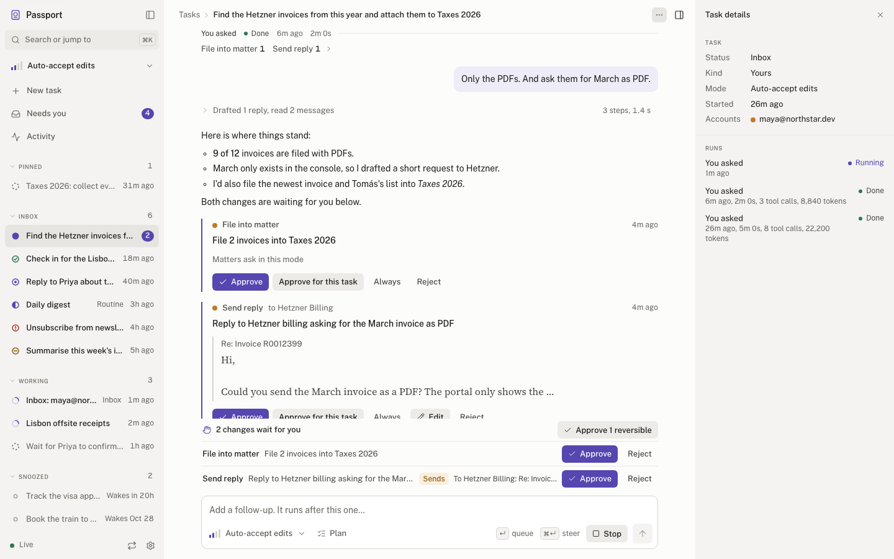
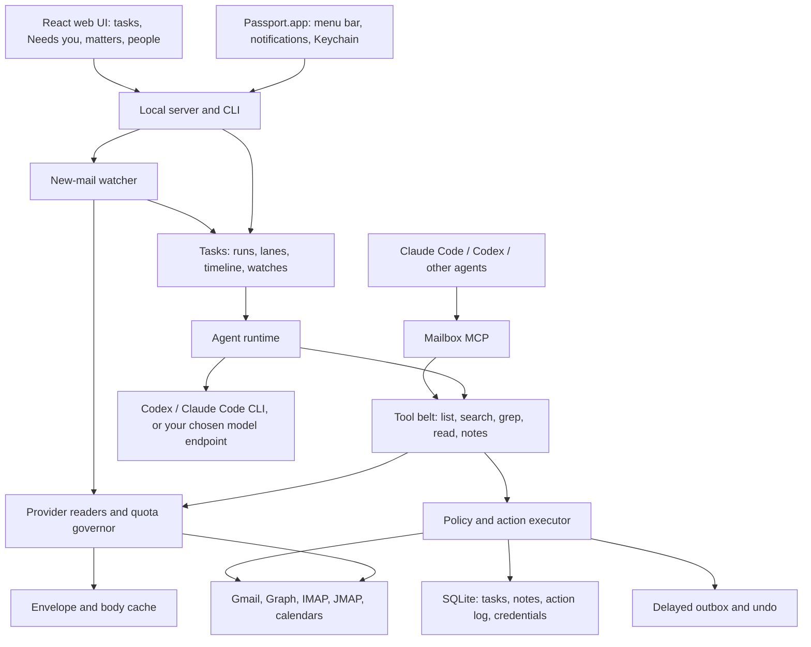

# Passport

Passport is an open-source, local-first email harness. AI agents work on your mail and calendar the way a coding agent works on a repository: they `ls`, `grep` and `read` the mailbox **on demand** through your provider's own search, keep notes about people and matters, and propose changes that pass through a trust policy you control.

**Passport reads your mail on demand and watches for new mail; it never mirrors or backfills.** Connecting an account takes a change cursor at "now", so the agent is usable the moment the account connects.

<picture>
  <source media="(prefers-color-scheme: dark)" srcset="docs/screenshots/task-dark.png">
  
</picture>

More screens: [starting a task](docs/screenshots/new-task.png), [Needs you](docs/screenshots/queue-light.png), [permission mode](docs/screenshots/permission-mode.png), [a matter](docs/screenshots/matter.png), [connecting an account](docs/screenshots/connect.png), [settings](docs/screenshots/settings.png) and the [command palette](docs/screenshots/command-palette.png).

## Why

- **Tasks are the unit of work.** Ask in plain language and Passport opens a [task](docs/tasks.md), like a coding agent's thread: each step it takes, collapsed tool calls ("Searched twice, read 4 messages"), a per-run change summary with undo, and approvals at the composer. Follow-ups queue or steer the running task. Tasks that need you come back to the inbox; the rest work, snooze or settle. New mail wakes each account's Inbox task, routines run as scheduled tasks, and `watch_conversation` wakes a task when someone replies.
- **A tool belt, not a mirror.** The [tools](docs/tools.md) map to coding primitives: `mail_labels` and `mail_list` (`ls`), `mail_search` (`grep`, Gmail `q`, Graph `$search`/`$filter`, IMAP and JMAP search), `mail_grep` (`grep -C`), `mail_read` and `mail_attachment_read` (`Read`), `mail_count` (`wc`), `mail_changes` (`git status`). Every result reports its quota cost; a per-account governor keeps interactive work ahead of background work.
- **Notes for people and matters.** The agent keeps memory-file notes on people and matters (`notes_read`, `notes_search`, `notes_write`), next to a small structured table for what policy depends on: relationship and sender verification, which notes can never change.
- **Earned trust.** Start supervised and grant autonomy per category as evidence accumulates. The ladder mirrors a coding agent's permission modes: `supervised`, `auto_accept_edits`, `auto`, `full_access`. A task's mode is capped by the ladder, and an external agent has a separate ceiling.
- **A record of every change.** Agent and human changes pass through the policy executor and action log. Reversible actions carry undo; irreversible operations are identified explicitly. Sends wait in a delayed outbox where you can cancel them.
- **Your providers, your subscription.** Connect Gmail, Outlook, IMAP or JMAP and calendar services. The agent runs on the Codex or Claude Code subscription already signed in on your computer; no API key needed. API providers and local Ollama models remain available.
- **A mailbox any agent can use.** The MCP server gives Claude Code, Codex and other clients the same policy-controlled tool belt as the built-in agent.

## Quickstart

**Pre-release:** there is no published release of 0.3 yet. Build the Mac app or the server from source, or use a locally packed tarball; the npm and GHCR commands below need a published version. Provider/model integrations have offline tests; real Gmail and Outlook sign-in and reads have not been verified against the live APIs (see [Status](#status)).

### Mac app (recommended on macOS)

Passport.app runs the same server in the background and keeps a menu-bar item with the number of tasks that need you. It notifies you when a task needs an approval or has failed, even with the window closed, and clicking a notification opens that task. It can start at login and keeps the encryption key in the macOS Keychain. There is no signed download yet, so build it on an Apple silicon Mac:

```sh
git clone https://github.com/akd-me/passport.git
cd passport
corepack enable
pnpm install --frozen-lockfile
PASSPORT_DESKTOP_DMG=1 pnpm dist:desktop   # → apps/desktop/dist/Passport-<version>-arm64.dmg and mac-arm64/Passport.app
```

Open the DMG and drag `Passport.app` to `/Applications`. It is unsigned and not notarized, so the first time, right-click it and choose **Open**, then **Open** again. It uses the same `~/.passport` workspace as the CLI; if `passport serve` is already running, the app attaches to it. See the [Mac app guide](docs/desktop.md) for logs, `passport://` links, the bundled `passport` command and the Keychain-held key.

The npm, Docker and source paths below run the same server on any platform, including headless home servers.

### Server: npx

Node **24** is recommended; the persistent backend needs **Node 22.16 or newer with SQLite FTS5**. Stock Node 22.5 has `node:sqlite` but lacks FTS5, so it runs the demo only. The installed shim reports this limitation before opening a persistent workspace.

```sh
npx @akd-me/passport demo
# Or start a persistent workspace:
npx @akd-me/passport serve
```

Open the login URL printed at startup. The offline demo uses in-memory fixtures, makes no provider/model requests and resets on restart. `serve` stores data in `~/.passport` (override with `PASSPORT_DATA_DIR`). If Codex or Claude Code is installed and signed in, the agent uses it automatically (see [Models](#models)); without any agent, the UI, on-demand reads, the new-mail watcher and MCP work while automatic triage is disabled.

For repeated use, install the executable:

```sh
npm install -g @akd-me/passport
passport --help
passport serve
```

The npm package is **`@akd-me/passport`**; its executable is **`passport`**. The unscoped npm name belongs to Passport.js.

### Server: Docker

```sh
git clone https://github.com/akd-me/passport.git
cd passport
cp .env.example .env
chmod 600 .env
docker compose up --build -d
```

Open **http://127.0.0.1:3000**. Compose keeps data in a named volume and publishes only to host loopback. The API requires a bearer token or browser session. Open the login URL printed at startup; `passport token` prints the API token again. Keep it on localhost or behind a private boundary. After a release, `docker compose pull && docker compose up -d --no-build` uses `ghcr.io/akd-me/passport:latest`. See [deployment](docs/deploy.md) for home servers, NAS, backups and remote access.

### Server: from source

```sh
git clone https://github.com/akd-me/passport.git
cd passport
nvm use                      # Node 24; or install Node 24 another way
corepack enable
pnpm install --frozen-lockfile
pnpm build
pnpm demo
# Persistent workspace: node apps/server/bin/passport.js serve
```

`pnpm dev` keeps the source demo in watch mode. For frontend editing, also run `pnpm --filter @passport/web dev` and open the URL Vite prints. The [installation guide](docs/install.md) covers configuration, tarballs and the package build.

## Connect Gmail or Outlook

Click **Connect another** in the sidebar (or **Settings → Accounts → Connect an account**), pick **Gmail** or **Microsoft**, and let the agent set it up
(or run `passport accounts connect --provider gmail|microsoft`). Your signed-in Codex (or Claude Code)
opens a browser, creates your own OAuth client in the Google Cloud console or Microsoft Entra, and asks
you only to sign in and approve access. **Connect calendar too** adds your primary calendar. The manual
steps, scopes and tenant settings are in [account setup](docs/accounts.md).

## Connect IMAP

Run `passport accounts add imap` with your provider's IMAP/SMTP hosts and an app password. Prefer TLS; IMAP and SMTP credentials are stored separately from public account settings. See [account setup](docs/accounts.md) for implicit TLS versus STARTTLS and supported provider capabilities.

Account onboarding is browser-based; `passport init` also offers first-account setup. Use `passport init --llm auto --skip-account` (or `--llm none`) for unattended initialization. Run setup on the same machine as the browser, or use the SSH tunnel described in [deployment](docs/deploy.md).

## Models

The default is your **Claude Code or Codex subscription**: no API key. Passport runs the `codex` and `claude` CLIs already installed and logged in on the host, the same way T3 Code does. At startup it picks, in order:

1. **Codex**, if installed and signed in (`codex login`, ChatGPT plan),
2. **Claude Code**, if installed and signed in (`claude auth login`, Claude plan),
3. an API provider you configured (Anthropic, OpenAI, OpenAI-compatible or Ollama),
4. otherwise no agent: mail, tasks you drive by hand, decisions and MCP still work.

`passport init` shows what it found ("Codex (ChatGPT login) ✓, Claude Code ✓") and lets you pick; **Settings → Model** does the same in the browser, and `passport doctor` explains how to fix a missing or signed-out CLI. Choosing an agent pins it; "Choose automatically" returns to the order above. Pin from the environment with `PASSPORT_LLM_PROVIDER=codex` or `claude-code` and `PASSPORT_LLM_MODEL`.

Each agent call is a fresh, non-persisted CLI run in a scratch directory under the data directory, with tools, shell and user plugins disabled; Passport executes every action itself, under policy. The CLIs receive a minimal environment (no `PASSPORT_*` secrets or provider API keys). Usage counts against your subscription's limits; there is no per-call cost. Defaults are `gpt-6.1-sol` / `gpt-5.6-luna` (Codex) and `claude-sonnet-5-5` / `claude-haiku-5-5` (Claude Code) for main and fast work. API keys are optional and only needed for the API providers under **advanced**; see [install](docs/install.md#models).

## Use it from Claude Code or Codex

After installing the CLI, register it in your Claude Code project's `.mcp.json`:

```sh
passport mcp install --client claude-code
passport mcp --help
```

This preserves other MCP entries, records the installed executable's absolute path and carries an explicit `PASSPORT_DATA_DIR` if set. Keep that installation available. Alternatively, add this entry manually to `.mcp.json` after npm publication:

```json
{
  "mcpServers": {
    "passport": {
      "command": "npx",
      "args": ["-y", "@akd-me/passport", "mcp"]
    }
  }
}
```

For Codex, use `passport mcp install --client codex` for stdio or `passport mcp install --client codex --http` for the authenticated HTTP endpoint **http://127.0.0.1:4318/mcp**. A manual HTTP registration must include the MCP bearer token:

```toml
[mcp_servers.passport]
url = "http://127.0.0.1:4318/mcp"
http_headers = { Authorization = "Bearer <PASSPORT_MCP_TOKEN or contents of ~/.passport/mcp-token>" }
```

The MCP token is separate from the UI/API token. Stdio shares the store in client mode and can coexist with `serve`; it starts no schedulers, watcher or arrival queue. Without `serve`, held/proposed work waits for the server. Docker keeps HTTP MCP inside the container; see [deployment](docs/deploy.md).

External agents use the shared executor and their trust ceiling. Human approval, outbox cancellation and undo remain available in the UI/API. An external agent cannot approve its own proposals or raise its ceiling. Mail and tool results are untrusted input; policy enforcement does not make prompt injection impossible.

## Scheduler and routines

The new-mail watcher (every 30 seconds by default, `watch.intervalSeconds`), calendar sync, outbox release, trust decay, daily digests and matter reviews run only in the `serve` (or `demo`) process that owns the data directory. Model routines run on their own routine tasks. USER.md supplies standing instructions; model-backed routines require a configured model. See [scheduler and routines](docs/scheduler.md).

## Architecture



| Workspace | Responsibility |
| --- | --- |
| `@passport/types` | Shared contracts and invariants, including tasks and `MailReader` |
| `@passport/store` | SQLite: envelope and body cache (no mirror), tasks, notes, action log, encrypted credentials, event bus |
| `@passport/providers` | Gmail, Graph, IMAP/SMTP, JMAP and calendar adapters; on-demand readers and the quota governor |
| `@passport/policy` | Trust, risk, action execution with fresh pre-images, delayed sends and undo |
| `@passport/tools` | The tool belt shared by the built-in agent and MCP |
| `@passport/agent` | Agent runtime, triage, people and matter notes, USER.md, digests and reviews |
| `@passport/mcp` | Policy-controlled tools over stdio and Streamable HTTP |
| `@passport/scheduler` | Persistent jobs: watcher ticks, calendar sync, outbox release, routines |
| `@passport/server` | Composition root, tasks, new-mail watcher, API, WebSockets and CLI |
| `@passport/web` | Tasks, Needs you, Matters, People, Trust and account UI |
| `@passport/desktop` | macOS app: Electron shell that runs the server as a child, menu bar, notifications, Keychain key, deep links |

The public **`@akd-me/passport`** artifact bundles the private workspace code and built web UI. The server workspace retains its development name. See the [engineering contract](docs/CONTRACT.md), the [v0.3 design](docs/design/on-demand.md) and the [server reference](apps/server/README.md).

## Security model

Passport is local-first: tasks, notes, the cache and the action history live on your machine. Provider credentials are encrypted at rest with AES-256-GCM under a master key: in the macOS Keychain for the Mac app (handed to its server on a private pipe, never in the environment), otherwise `PASSPORT_MASTER_KEY` or a generated private `master.key`. Cached message envelopes and bodies and the database itself are **not** encrypted by Passport; use OS disk encryption and protect backups.

Mail, subjects and attachments are **untrusted data**: tool results and task prompts wrap them as data, not instructions. The agent can read and propose; every write goes through the executor under the task's permission mode, the trust ladder and, for MCP clients, the external-agent ceiling. Agents cannot approve their own proposals or change trust. Page tokens handed to agents are sealed, so an edited token cannot point a reader somewhere else.

Mail/calendar providers receive the reads and actions you authorize. Beyond those, the agent sends relevant context only to the model you choose (through the Codex or Claude Code CLI and its vendor, or your configured endpoint); there is no Passport telemetry service or required hosted backend. External MCP clients can read mailbox content and have their own data handling policies. The HTTP API is authenticated with the startup token (`passport token`) or a browser session, with Host and Origin checks. See [SECURITY.md](SECURITY.md) and [docs/security.md](docs/security.md).

**Offline search is partial, on purpose.** When a provider cannot be reached, reads fall back to what is cached, marked with how stale it is, and writes to cached mail are refused until Passport can read the current state again. Passport does not keep a searchable copy of your whole mailbox.

## Status

**0.3.2 was tagged on 2026-10-24** (not yet published to npm or GHCR). What is verified, and how:

| Area | State |
| --- | --- |
| On-demand reads, watcher, tasks, tools, policy, MCP | Offline tests against fixtures and fake provider endpoints |
| Real Gmail and Outlook OAuth sign-in, reads and the watcher | **Not verified** against the live APIs |
| IMAP and JMAP against real servers | Not verified |
| Mac app (unsigned, arm64) | Built and smoke-tested locally: the packaged server starts, signs in and stops on quit |
| Signing, notarization, auto-update | **Not done**; right-click → **Open** on first launch |
| npm, GHCR and release workflow | Not yet live-published |

Deferred: Gmail Pub/Sub push and Graph subscriptions (the watcher polls), a deep local index, OCR for scanned attachments, staged task changes (approval is per action), and task-scoped "accept always". **Hosted identity and SMTP+ are parked.** See [CHANGELOG.md](CHANGELOG.md).

## Contributing

Read [CONTRIBUTING.md](CONTRIBUTING.md) and [docs/CONTRACT.md](docs/CONTRACT.md). Use offline fixtures for tests and keep all domain writes behind the action executor.

```sh
pnpm build
pnpm lint
pnpm test
pnpm run pack
node scripts/smoke-package.mjs apps/server/dist/akd-me-passport-<version>.tgz
pnpm --filter @passport/desktop test
```

`<version>` is the first release heading in `CHANGELOG.md`. The package smoke test installs the tarball in a temporary directory, checks CLI help and MCP install `--dry-run`, and boots demo and persistent servers on free ports. It reads their startup login tokens and curls `/api/health` with bearer authentication, checks decisions and UI assets, and fails on any error. See the [installation guide](docs/install.md#pack-and-test-the-installable-artifact).

CI checks Node 22 and 24, with a separate package-smoke job after build/tests. Tagged releases publish npm provenance, a GHCR image and changelog release notes; [maintainer setup](docs/deploy.md#releasing) describes the required permissions and secrets.

## License

[MIT](LICENSE).
