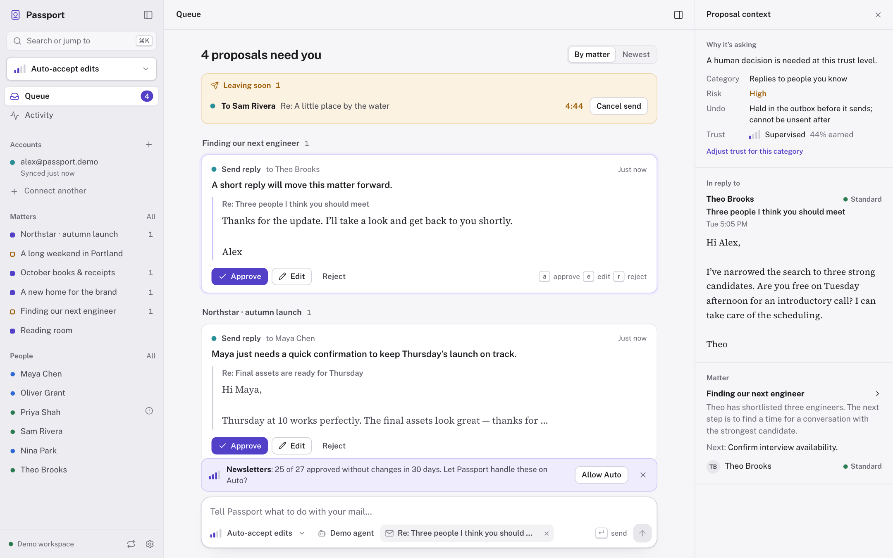
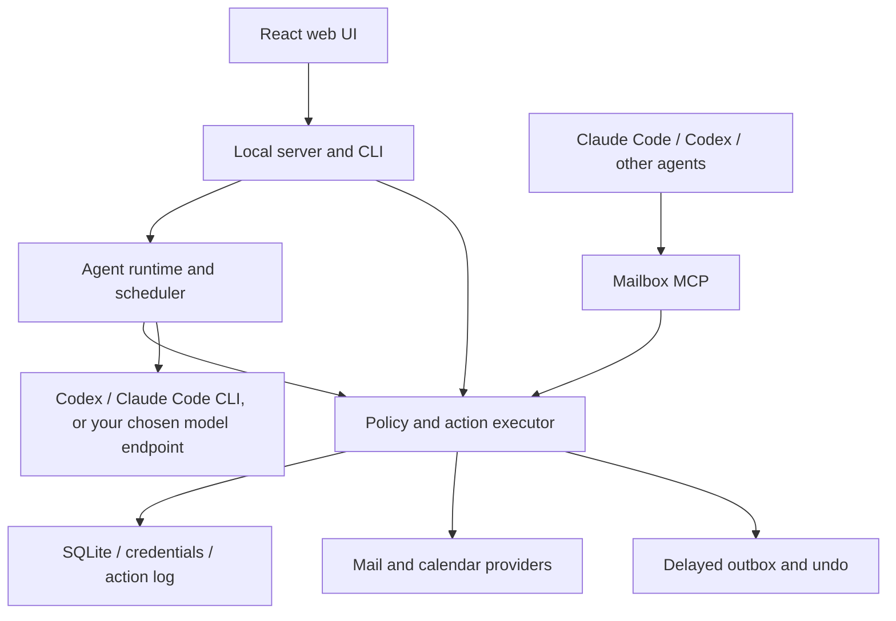

# Passport

Passport is an open-source, local-first email harness where AI agents handle mail and calendar through a trust policy you control. You see decisions, build context around people and matters, and bring your own mail providers, models and agents.

<picture>
  <source media="(prefers-color-scheme: dark)" srcset="docs/screenshots/queue-dark.png">
  
</picture>

More screens: [permission mode](docs/screenshots/permission-mode.png), [a matter](docs/screenshots/matter.png), [connecting an account](docs/screenshots/connect.png), [settings](docs/screenshots/settings.png) and the [command palette](docs/screenshots/command-palette.png).

## Why

Your inbox is organized around **the person** and **the matter**: who you are dealing with, and what you are trying to get done. AI handles routine mail, prepares replies and keeps that context current; you see the decisions that need your attention.

- **Earned trust.** Start supervised and grant autonomy per category as evidence accumulates. The ladder mirrors a coding agent's permission modes: `supervised`, `auto_accept_edits`, `auto`, `full_access`. An external agent has a separate ceiling.
- **A record of every change.** Agent and human changes pass through the policy executor and action log. Reversible actions carry undo; irreversible operations are identified explicitly.
- **Time to change your mind.** Sends wait in a delayed outbox where you can cancel them. A delivered message cannot be unsent.
- **Your providers, your subscription.** Connect Gmail, Outlook or IMAP and calendar services. The agent runs on the Codex or Claude Code subscription already signed in on your computer; no API key needed. API providers and local Ollama models remain available.
- **A mailbox any agent can use.** The MCP server gives Claude Code, Codex and other clients the same policy-controlled tools as the built-in agent.

## Quickstart

**Pre-release:** npm and GHCR commands below are the release installation paths. They require a published version; until the first release, build from source or use a locally packed tarball. Provider/model integrations have offline tests; this repository does not claim live Gmail, Outlook, IMAP or LLM delivery validation.

### 1. npx

Node **24** is recommended; the persistent backend needs **Node 22.16 or newer with SQLite FTS5**. Stock Node 22.5 has `node:sqlite` but lacks FTS5, so it runs the demo only. The installed shim reports this limitation before opening a persistent workspace.

```sh
npx @akd-me/passport demo
# Or start a persistent workspace:
npx @akd-me/passport serve
```

Open the login URL printed at startup. The offline demo uses in-memory fixtures, makes no provider/model requests and resets on restart. `serve` stores data in `~/.passport` (override with `PASSPORT_DATA_DIR`). If Codex or Claude Code is installed and signed in, the agent uses it automatically (see [Models](#models)); without any agent, the UI, account sync and MCP work while automatic triage is disabled.

For repeated use, install the executable:

```sh
npm install -g @akd-me/passport
passport --help
passport serve
```

The npm package is **`@akd-me/passport`**; its executable is **`passport`**. The unscoped npm name belongs to Passport.js.

### 2. Docker

```sh
git clone https://github.com/akd-me/passport.git
cd passport
cp .env.example .env
chmod 600 .env
docker compose up --build -d
```

Open **http://127.0.0.1:3000**. Compose keeps data in a named volume and publishes only to host loopback. The API requires a bearer token or browser session. Open the login URL printed at startup; `passport token` prints the API token again. Keep it on localhost or behind a private boundary. After a release, `docker compose pull && docker compose up -d --no-build` uses `ghcr.io/akd-me/passport:latest`. See [deployment](docs/deploy.md) for home servers, NAS, backups and remote access.

### 3. From source

```sh
git clone https://github.com/akd-me/passport.git
cd passport
nvm use                      # Node 24; or install Node 24 another way
corepack enable
pnpm install --frozen-lockfile
pnpm build
pnpm demo
# Persistent workspace: node apps/server/bin/passport.js serve
```

`pnpm dev` keeps the source demo in watch mode. For frontend editing, also run `pnpm --filter @passport/web dev` and open the URL Vite prints. The [installation guide](docs/install.md) covers configuration, tarballs and the package build.

## Connect Gmail or Outlook

Open **Accounts → Add account**, pick **Gmail** or **Microsoft Outlook** and click **Set up with my agent**
(or run `passport accounts connect --provider gmail|microsoft`). Your signed-in Codex (or Claude Code)
opens a browser, creates your own OAuth client in the Google Cloud console or Microsoft Entra, and asks
you only to sign in and approve access. **Connect calendar too** adds your primary calendar. The manual
steps, scopes and tenant settings are in [account setup](docs/accounts.md).

## Connect IMAP

Run `passport accounts add imap` with your provider's IMAP/SMTP hosts and an app password. Prefer TLS; IMAP and SMTP credentials are stored separately from public account settings. See [account setup](docs/accounts.md) for implicit TLS versus STARTTLS and supported provider capabilities.

Account onboarding is browser-based; `passport init` also offers first-account setup. Use `passport init --llm auto --skip-account` (or `--llm none`) for unattended initialization. Run setup on the same machine as the browser, or use the SSH tunnel described in [deployment](docs/deploy.md).

## Models

The default is your **Claude Code or Codex subscription**: no API key. Passport runs the `codex` and `claude` CLIs already installed and logged in on the host, the same way T3 Code does. At startup it picks, in order:

1. **Codex**, if installed and signed in (`codex login`, ChatGPT plan),
2. **Claude Code**, if installed and signed in (`claude auth login`, Claude plan),
3. an API provider you configured (Anthropic, OpenAI, OpenAI-compatible or Ollama),
4. otherwise no agent: mail, decisions and MCP still work.

`passport init` shows what it found ("Codex (ChatGPT login) ✓, Claude Code ✓") and lets you pick; **Accounts → Your agent** does the same in the browser, and `passport doctor` explains how to fix a missing or signed-out CLI. Choosing an agent pins it; "Choose automatically" returns to the order above. Pin from the environment with `PASSPORT_LLM_PROVIDER=codex` or `claude-code` and `PASSPORT_LLM_MODEL`.

Each agent call is a fresh, non-persisted CLI run in a scratch directory under the data directory, with tools, shell and user plugins disabled; Passport executes every action itself, under policy. The CLIs receive a minimal environment (no `PASSPORT_*` secrets or provider API keys). Usage counts against your subscription's limits; there is no per-call cost. Defaults are `gpt-6.1-sol` / `gpt-5.6-luna` (Codex) and `claude-sonnet-5-5` / `claude-haiku-5-5` (Claude Code) for main and fast work. API keys are optional and only needed for the API providers under **advanced**; see [install](docs/install.md#models).

## Use it from Claude Code or Codex

After installing the CLI, register it in your Claude Code project's `.mcp.json`:

```sh
passport mcp install --client claude-code
passport mcp --help
```

This preserves other MCP entries, records the installed executable's absolute path and carries an explicit `PASSPORT_DATA_DIR` if set. Keep that installation available. Alternatively, add this entry manually to `.mcp.json` after npm publication:

```json
{
  "mcpServers": {
    "passport": {
      "command": "npx",
      "args": ["-y", "@akd-me/passport", "mcp"]
    }
  }
}
```

For Codex, use `passport mcp install --client codex` for stdio or `passport mcp install --client codex --http` for the authenticated HTTP endpoint **http://127.0.0.1:4318/mcp**. A manual HTTP registration must include the MCP bearer token:

```toml
[mcp_servers.passport]
url = "http://127.0.0.1:4318/mcp"
http_headers = { Authorization = "Bearer <PASSPORT_MCP_TOKEN or contents of ~/.passport/mcp-token>" }
```

The MCP token is separate from the UI/API token. Stdio shares the store in client mode and can coexist with `serve`; it starts no schedulers or arrival queue. Without `serve`, held/proposed work waits for the server. Docker keeps HTTP MCP inside the container; see [deployment](docs/deploy.md).

External agents use the shared executor and their trust ceiling. Human approval, outbox cancellation and undo remain available in the UI/API. Mail and tool results are untrusted input; policy enforcement does not make prompt injection impossible.

## Scheduler and routines

Periodic account sync, outbox release, trust decay, daily digests and matter reviews run only in the `serve` (or `demo`) process that owns the data directory. USER.md supplies standing instructions; model-backed routines require a configured model. See [scheduler and routines](docs/scheduler.md).

## Tool catalogue

Search and read mail, prepare drafts, organize matters and people, and work with calendars through the mailbox MCP tools. Writes enter the same action pipeline as the UI. See the [tool catalogue](docs/tools.md) for names, schemas and permission behavior.

## Architecture



| Workspace | Responsibility |
| --- | --- |
| `@passport/types` | Shared contracts and invariants |
| `@passport/store` | SQLite, FTS5, encrypted credentials and event bus |
| `@passport/providers` | Gmail, Graph, IMAP/SMTP, JMAP and calendar adapters |
| `@passport/policy` | Trust, risk, action execution, delayed sends and undo |
| `@passport/agent` | Triage, people/matter context, USER.md, digests and reviews |
| `@passport/mcp` | Policy-controlled tools over stdio and Streamable HTTP |
| `@passport/server` | Composition root, API, WebSockets, CLI and background jobs |
| `@passport/web` | Decisions, Matters, People, Trust and account UI |

The public **`@akd-me/passport`** artifact bundles the private workspace code and built web UI. The server workspace retains its development name. See the [engineering contract](docs/CONTRACT.md) and [server reference](apps/server/README.md).

## Security model

Passport is local-first: the database and action history live on your machine. Provider credentials are encrypted at rest with AES-256-GCM using `PASSPORT_MASTER_KEY` or a generated private `master.key`. Message bodies and the database itself are **not** encrypted by Passport; use OS disk encryption and protect backups. Model keys supplied in the environment are not copied into config; a key you put in the config file remains there.

Mail/calendar providers receive the normal synchronization and action requests you authorize. Beyond those connections, the agent sends relevant context only to the model you choose (through the Codex or Claude Code CLI and its vendor, or your configured endpoint); there is no Passport telemetry service or required hosted backend. External MCP clients can read mailbox content and have their own data handling policies. A local model can keep inference local.

Trust gates and the external-agent ceiling constrain actions. Sends are held before delivery when a hold is configured; reversible changes are logged with undo. Sender verification is derived from headers/signatures, never message content; production Passport identity verification is not wired yet. The HTTP API is authenticated with the startup token (`passport token`) or a browser session, with Host and Origin checks. See [SECURITY.md](SECURITY.md) for the threat model and private reporting.

## Status and roadmap

This is an early **0.1.0, unreleased** implementation. The offline suite covers policy integration, resumable arrivals and calendar release checks. Live provider/model interoperability and hosted deployment must be validated in your environment.

Near-term work includes live provider validation and deployment verification. **Hosted identity and SMTP+ are parked.** Gmail/Graph/JMAP push subscriptions and contacts sync are not implemented; periodic sync is available. See [CHANGELOG.md](CHANGELOG.md).

## Contributing

Read [CONTRIBUTING.md](CONTRIBUTING.md) and [docs/CONTRACT.md](docs/CONTRACT.md). Use offline fixtures for tests and keep all domain writes behind the action executor.

```sh
pnpm build
pnpm typecheck
pnpm lint
pnpm test
pnpm run pack
node scripts/smoke-package.mjs apps/server/dist/akd-me-passport-0.1.0.tgz
```

The package smoke test installs the tarball in a temporary directory, checks CLI help and MCP install `--dry-run`, and boots demo and persistent servers on free ports. It reads their startup login tokens and curls `/api/health` with bearer authentication, checks decisions and UI assets, and fails on any error. See the [installation guide](docs/install.md#pack-and-test-the-installable-artifact).

CI checks Node 22 and 24, with a separate package-smoke job after build/tests. Tagged releases publish npm provenance, a GHCR image and changelog release notes; [maintainer setup](docs/deploy.md#releasing) describes the required permissions and secrets.

## License

[MIT](LICENSE).
